<div align="center">

<picture>
  <source media="(prefers-color-scheme: dark)" srcset="docs/media/hero-dark.svg">
  
</picture>

**Give your agent an API for websites that don't have one.**<br>
Learn a read once from the site's own traffic. Call it as JSON from MCP, the CLI, or your code.

[](https://www.npmjs.com/package/api-anything)
[](https://api-anything-registry.forth-site.workers.dev)
[](https://github.com/goodnight000/api-anything/actions/workflows/ci.yml)
[](LICENSE)
[](INSTALL.md)

[Quick start](#quick-start) · [Example](#whos-talking-about-your-project) · [Benchmarks](#performance) · [Integrations](#use-it-anywhere) · [Docs](#docs)

</div>

Look up a book rating, search for flights, or check who's talking about your project without
driving a browser for each read. API Anything ships **114 sites and 323 read operations**. It
uses plain HTTP when it can, falls back to the browser when needed, and can repair an operation
when a site changes. Calls run on your machine, not through the shared catalog.

## Quick start

**Try a read.** All you need is Node 22.13 or newer. No browser, account, or API key for this call.

```sh
npx -y api-anything call hacker-news search query=sqlite --fields title,url --max-tier 1
```

```text
{"ok":true,"class":"ok","tier":1,"data":[
  {"title":"Hosting SQLite databases on GitHub Pages or any static file hoster",
   "url":"https://phiresky.github.io/blog/2021/hosting-sqlite-databases-on-github-pages/"},
  ...]}
```

`tier: 1` means plain HTTP, with no browser. `--fields` keeps only what you ask for. If a call
fails, it returns a reason and a next step.

**Connect your agent.**

```sh
npx -y api-anything setup
```

Pick your client, restart it, and ask *“What does Goodreads rate Piranesi?”* Setup supports
Claude Code, Codex, Cursor, Claude Desktop, Gemini CLI, and VS Code; use `--agents hermes` for
Hermes. Use `--local-only` to skip the shared catalog. [Setup for every client](docs/QUICKSTART.md) ·
[Install instructions for your agent](INSTALL.md)

## Who's talking about your project

[`examples/mentions.mjs`](examples/mentions.mjs) checks Hacker News, Reddit, YouTube, GitHub, and
Mastodon in one run and combines the links into a feed. It makes six read calls, all capped at plain
HTTP. If one source is unavailable, the script reports it and keeps the answers from the others.

On November 22, all five runs found **46 DuckDB mentions**. The whole process took **1.56–1.89 s**
per run. Five calls answered over plain HTTP; Reddit reported `blocked` each time.
[Rerun details](bench/README.md#november-22-rerun)

```sh
npm ci
node examples/mentions.mjs duckdb --json
```

[](docs/demos/README.md#6-whos-talking-about-a-project)

<sub>[Watch the November 6 recording](docs/demos/README.md#6-whos-talking-about-a-project)</sub>

## Performance

**60% less time for a fresh CLI read.** On November 22, we reran the local benchmarks on
current `main` against the revisions before the latency passes.

| Local workload | Before | Current |
| --- | ---: | ---: |
| First CLI read, including Node startup | 574 ms | **227 ms** |
| Recognize a rate limit and return | 4.59 s, misclassified | **14 ms**, with retry timing |
| Stop learning on an unresolved challenge | 36.0 s, two browser runs | **18.0 s**, one browser run |
| Five-read batch, one field requested per item | 3,355 JSON characters | **60 JSON characters** |

These are localhost fixtures: the first read includes process startup, and the batch measures
output size, not model tokens or a faster site. [Reproduction, baselines, and raw results](bench/README.md#november-22-rerun)

### The race

In earlier same-agent comparisons, both setups answered every scored question correctly. The
times below include the agent's entire run, not just the website call.

| Task | Browser agent | Agent with API Anything |
| --- | ---: | ---: |
| Google Flights, 1 date (Sep 28) | 12.9 s | **8.4 s** |
| Google Flights, 5 dates (Sep 28) | 41.6 s | **21.1 s** |
| Netflix, 3 episodes (Oct 31) | 22.3 s | **9.6 s** |
| IKEA, 5 store addresses (Oct 31) | 31.4 s | **18.1 s** |

Historical 2026 medians, five runs per task and setup, all with Claude Opus 5.5. These are not
current-build timings. [Watch the Google Flights race](docs/media/agent-race.mp4) ·
[Agent timing, tokens, and cost](bench/README.md#popular-site-results-2026-10-31)

## How it works

<picture>
  <source media="(prefers-color-scheme: dark)" srcset="docs/media/how-it-works-dark.svg">
  
</picture>

- **Learn.** A headless browser loads the page for two example inputs. What changed becomes a
  parameter, the rest is kept byte for byte, and cookies become references. No LLM is involved.
- **Call.** Send the request with Node's `fetch`. If the site blocks that, fetch from inside a
  browser page; as a last resort for a read, run the page and read its answer.
- **Repair.** When the answer stops fitting, try an updated operation from the catalog or re-learn
  it. A repaired operation is saved only after a successful replay.

[The whole idea in 49 seconds](docs/media/explainer.mp4) · [replay, fallback and repair](docs/REFERENCE.md#replay-fallback-and-repair) · [design](docs/DESIGN.md)

## Use it anywhere

The same operations work from an agent, a script, or an app.

| Use it from | Start here |
| --- | --- |
| **MCP** | [Set up your agent](docs/QUICKSTART.md) or [connect an agent framework](docs/INTEGRATIONS.md) |
| **CLI** | [Call operations or batch reads as JSONL](docs/REFERENCE.md#read-batches-and-stdin) |
| **TypeScript** | `import { call } from "api-anything"`, or use the [call-only host API](docs/HOST.md) |
| **Python** | [Use the Python client](docs/PYTHON.md) with typed operations or framework adapters |
| **HTTP** | [Run a local server](docs/SERVE.md) with REST, OpenAPI, and MCP over HTTP |

- **Give agents less to read.** Select fields and cap output on calls, including MCP batches.
  If a kept answer was cut short, `get_result` retrieves the rest locally, without calling the
  site again. [Result views and continuation](docs/REFERENCE.md#result-views-and-local-continuation)
- **Watch for changes.** Use `--changes` to report what's new, gone, or different, and
  `--max-age` to reuse a recent answer. [Watcher example](examples/watch.mjs)

## Teach it a new site

If the catalog doesn't have the read you need, give `learn_site` a page URL template and three
values: two to learn from and a third to check the result. From a shell:

```sh
api-anything learn 'https://lobste.rs/domains/{domain}' \
  --args domain=github.com --args2 domain=arxiv.org --args3 domain=youtube.com
```

For pages that need clicks or typing, the [agent skill](skills/api-anything/SKILL.md) walks the
agent through proposing and building an operation after you approve.
[Learning, step by step](docs/QUICKSTART.md#learning-an-operation) ·
[Watch a read get learned and reused](docs/demos/README.md#2-teach-once-call-with-new-inputs)

## The shared catalog

<picture>
  <source media="(prefers-color-scheme: dark)" srcset="docs/media/flywheel-dark.svg">
  
</picture>

Search the [shared catalog](https://api-anything-registry.forth-site.workers.dev) for learned
operations or a site's own MCP server or OpenAPI document. Opt in to sharing to contribute public
reads and repairs. Other installs verify shared operations before they go live. The
[bundled sites](docs/REFERENCE.md#bundled-sites) work without reaching the catalog and cover selected
features, not whole sites. [How the catalog verifies and promotes operations](docs/REGISTRY.md)

## Safety and what leaves your machine

- **Calls run here**, on your machine, network and sessions. The catalog never proxies your calls;
  a few public operations can be tried from the catalog page.
- **Sessions stay local.** Operation specs reference cookies rather than containing their values.
  `login` imports a site's cookies from the browser you choose.
  [Session storage and encryption](docs/REFERENCE.md#logging-in)
- **Writes are off** unless allowed, sent once, refused as `duplicate` if repeated, and reported
  `applied` only when a read finds the result. No write operation is bundled.
  [Every write guard](docs/REFERENCE.md#write-guards-in-short)

### What leaves your machine

A search sends its words, domain or URL to the catalog, which keeps no search words. With sharing on,
operations learned from public pages are shared, and so are repairs and reports (the version, the
outcome, the tier and the time; never your arguments or data). An operation learned signed in goes
only after you say yes, or once 3 installs on 3 networks learned the identical thing. Background
verification of new operations is a separate question, and its default is no. With sharing off,
or with `--local-only`, nothing is shared or reported.
[In full, with what the gate checks](docs/REFERENCE.md#what-leaves-your-machine)

## Limits

It knows only the operations someone taught it, and the catalog is young. An operation that works
for others can still fail for you (another region, a block on your network: Reddit challenges plain
HTTP from many). There's no CAPTCHA solving; a challenge that doesn't clear is reported as
`blocked`. Read each site's terms: you're responsible for how you use it.
[All limits](docs/REFERENCE.md#status-and-known-limits)

## Help build it

Opt in to sharing to help verify and repair the operations you use. Learn a site that agents
requested on the [catalog homepage](https://api-anything-registry.forth-site.workers.dev), or
[contribute a bundled site spec](CONTRIBUTING.md).

## Docs

| doc | what's in it |
|---|---|
| [Setup for agents](docs/QUICKSTART.md) | install, connect each client, learning, timeouts, troubleshooting |
| [Reference](docs/REFERENCE.md) | the CLI and library, results, creating operations, repair, logging in, safety, sites, limits |
| [HTTP server](docs/SERVE.md) · [Python](docs/PYTHON.md) | `api-anything serve`; the Python package |
| [Frameworks](docs/INTEGRATIONS.md) · [Agent hosts](docs/HOST.md) | MCP from agent frameworks; the call-only host API |
| [Design](docs/DESIGN.md) · [Catalog](docs/REGISTRY.md) | the authoritative spec and its reasons; how the catalog promotes, stores and trusts |
| [Benchmark](bench/README.md) · [Demos](docs/demos/README.md) | how every number here was measured; recorded runs with transcripts and tapes |
| [Contributing](CONTRIBUTING.md) · [MIT license](LICENSE) | add a site spec, run the checks |

## Who made this

API Anything is made by [Charles Zheng](https://charleszheng.com), who also builds
[Forth](https://getforth.co). Say hi on [X](https://x.com/Charles_Zheng00) or
[LinkedIn](https://www.linkedin.com/in/charles-zheng-3234211aa).

## Star History

<a href="https://www.star-history.com/?repos=goodnight000/api-anything&type=date&legend=bottom-right">
 <picture>
   <source media="(prefers-color-scheme: dark)" srcset="https://api.star-history.com/chart?repos=goodnight000/api-anything&type=date&theme=dark&legend=bottom-right" />
   <source media="(prefers-color-scheme: light)" srcset="https://api.star-history.com/chart?repos=goodnight000/api-anything&type=date&legend=bottom-right" />
   
 </picture>
</a>
