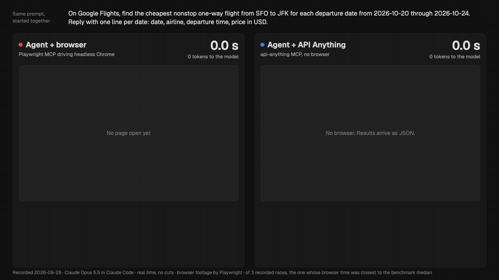
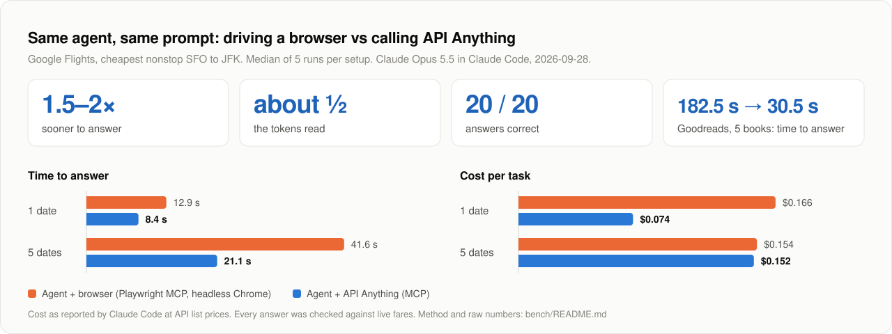
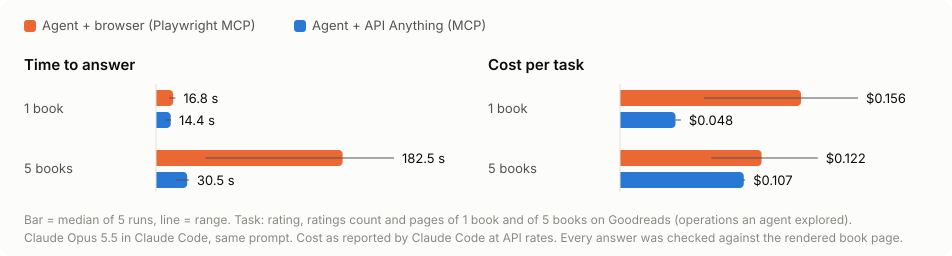

<div align="center">

<picture>
  <source media="(prefers-color-scheme: dark)" srcset="docs/media/hero-dark.svg">
  
</picture>

**Your agent learns a site's own request once, then calls it like an API and gets JSON back.**<br>
Plain HTTP first, a browser only when the site insists, no LLM to learn it, and a repair when the site changes.

[](https://github.com/goodnight000/api-anything/actions/workflows/ci.yml)
[](LICENSE)
[](INSTALL.md)
[](#use-it-from-your-agent-the-cli-or-code)

[Quick&nbsp;start](#quick-start) · [How&nbsp;it&nbsp;works](#how-it-works) · [Agents](#use-it-from-your-agent-the-cli-or-code) · [Teach&nbsp;a&nbsp;site](#teach-it-a-new-site) · [Results](#results-you-can-act-on) · [Sites](#bundled-sites) · [Docs](#docs)

</div>

<br>

<a href="docs/media/explainer.mp4"></a>

<p align="center"><sub>The whole idea in 49 seconds · <a href="docs/media/explainer.mp4">MP4 with sharper text</a></sub></p>

## The race

Same agent, same prompt, started together. Left: it drives headless Chrome. Right: it calls API
Anything's Google Flights operation.

[](docs/media/agent-race.mp4)

<p align="center"><b>1.5 to 2× sooner · about half the tokens · the same cost or less · 20 of 20 answers correct</b></p>

<sub>Claude Opus 5.5 in Claude Code, 2026-09-28. Shown at 3× speed with no cuts; the timers show
real elapsed time. [MP4](docs/media/agent-race.mp4) · [how it was recorded](bench/README.md#the-recorded-race)</sub>

<picture>
  <source media="(prefers-color-scheme: dark)" srcset="docs/media/benchmark-dark.svg">
  
</picture>

One site, one model, a few dozen runs. [Method, raw numbers and limits](bench/README.md).

## Quick start

**1. Paste this into Claude Code, Codex or another coding agent:**

```text
Set up API Anything for me: https://github.com/goodnight000/api-anything/blob/main/INSTALL.md
```

The agent checks for Node 22.13+, builds and installs the `api-anything` command, makes one call to
prove it works, then connects the MCP server and the skill to itself.

**2. Restart the agent and ask it something:**

> What does Goodreads rate Piranesi?

**3. Or call an operation yourself:**

```sh
api-anything call hacker-news search query=sqlite
```

```text
{"ok":true,"class":"ok","tier":1,"data":[
  {"title":"Hosting SQLite databases on GitHub Pages or any static file hoster", ...}, ...],
 "ms":185}
```

`tier: 1` means one plain HTTP request, with no browser and no account. A failure says what
happened (`class`), why (`reason`) and what to do next (`next`).

[](docs/demos/README.md#4-pull-a-shared-spec-and-call-it)

<details>
<summary><b>Install by hand</b></summary>

<br>

The package isn't on npm yet, so build it from a clone. Don't use `npm install -g github:...`:
it fails under npm 11.

```sh
git clone https://github.com/goodnight000/api-anything.git && cd api-anything
npm ci && npm install -g "$(npm pack --silent)"
api-anything call hacker-news search query=sqlite
```

Then connect your agent:

```sh
claude mcp add --scope user api-anything -- api-anything mcp   # Claude Code
codex mcp add api-anything -- api-anything mcp                 # Codex
api-anything mcp --print-config                                # any other client
```

To try one read with no install: `npx -y github:goodnight000/api-anything call hacker-news search query=sqlite`.

A Chromium browser is needed only to teach new sites and for the browser tiers: Google Chrome by
default, or Brave, Edge, Chromium, Vivaldi or Arc. `API_ANYTHING_BROWSER` names any other.
[Setup details](docs/QUICKSTART.md).

</details>

## How it works

<picture>
  <source media="(prefers-color-scheme: dark)" srcset="docs/media/how-it-works-dark.svg">
  
</picture>

- **Learn.** A headless browser loads the page once for each of two example inputs. The part of
  the request that changed becomes a slot. Cookies and tokens become references to a local store.
- **Call.** Fill the slots and send the request with Node's `fetch`. If the site blocks that, fetch
  from inside a browser page. As a last resort for a read, run the page and read its own response.
- **Repair.** When the answer stops fitting (a rotated id, a moved field), re-learn the request and
  save it only after a replay works. Otherwise the call returns an error, never someone else's data.

[Replay, fallback and repair in detail](docs/REFERENCE.md#replay-fallback-and-repair) · [design](docs/DESIGN.md)

## What you get

<table>
<tr>
<td width="50%" valign="top">
<picture><source media="(prefers-color-scheme: dark)" srcset="docs/media/feature-learn-dark.svg"></picture>
<br><b>No LLM to learn</b><br>
Two example inputs. What changed becomes a parameter; the rest is kept byte for byte.
</td>
<td width="50%" valign="top">
<picture><source media="(prefers-color-scheme: dark)" srcset="docs/media/feature-fast-dark.svg"></picture>
<br><b>Plain HTTP, no browser</b><br>
Tier 1 is one request from Node: typically 0.1 to 0.4 s for a Hacker News search, 1.2 s for a Google Flights page.
</td>
</tr>
<tr>
<td width="50%" valign="top">
<picture><source media="(prefers-color-scheme: dark)" srcset="docs/media/feature-heals-dark.svg"></picture>
<br><b>Repairs itself</b><br>
A drifted request is re-learned, and saved only after a replay with your inputs works.
</td>
<td width="50%" valign="top">
<picture><source media="(prefers-color-scheme: dark)" srcset="docs/media/feature-writes-dark.svg"></picture>
<br><b>Honest about writes</b><br>
Off unless allowed, sent once, a repeat refused, and <code>applied</code> only when a read finds it.
</td>
</tr>
<tr>
<td width="50%" valign="top">
<picture><source media="(prefers-color-scheme: dark)" srcset="docs/media/feature-sessions-dark.svg"></picture>
<br><b>Your sessions, never in a spec</b><br>
Specs hold references like <code>cookie:ct0</code>. Logins come from the browser you already use.
</td>
<td width="50%" valign="top">
<picture><source media="(prefers-color-scheme: dark)" srcset="docs/media/feature-share-dark.svg"></picture>
<br><b>Share and pull specs</b><br>
Pull what someone else learned. Publish yours as a pull request, after the same checks.
</td>
</tr>
</table>

## Use it from your agent, the CLI or code

**Over MCP**, an agent calls operations. It doesn't need a shell for that.

| tool | what it does |
|---|---|
| `list_sites` | the sites, with how many operations each has |
| `list_operations` | a site's operations, each with a JSON Schema of its args, and the site's notes |
| `call_operation` | call a read; it never sends a write |
| `call_write_operation` | call a write; exists only on a server started with `--allow-writes` |
| `get_job` | the result of a call that was still running after about 25 s |
| `login` | refresh a session from the browser profile you chose, or open a window to sign in |

Each answer is JSON text, and an object answer is also sent as `structuredContent`. To **create** operations, an
agent needs a shell and the [skill](skills/api-anything/SKILL.md).

<details>
<summary><b>Setup for each client, typed tools, slow calls</b></summary>

<br>

`--print-config` prints the add command for Claude Code, Codex, Gemini CLI and VS Code, and the JSON
entry for Cursor and Claude Desktop. It uses absolute paths, because a client started from the Dock
or a menu may not get your shell's `PATH`:

```sh
api-anything mcp --print-config                      # reads only
api-anything mcp --print-config --allow-writes       # also serve call_write_operation
```

`--sites` also serves each operation of the sites you name as a tool of its own, with its args as a
JSON Schema, so the agent skips the `list_operations` step. Each op costs about 200 tokens of tool
list, so it's opt-in:

```sh
api-anything mcp --sites goodreads,hacker-news       # goodreads__searchBooks, ...
```

A tool call still running after about 25 s (a sign-in window, a long repair) answers
`class: "pending"` with a `job`, and keeps running. `get_job` waits for it and never runs it again.
The same call made while it runs joins it, so a second `login` doesn't open a second window, and a
write still in flight is never sent beside itself.

[Client timeouts](docs/QUICKSTART.md#client-timeouts) · [troubleshooting](docs/QUICKSTART.md#troubleshooting)

</details>

<details>
<summary><b>CLI</b></summary>

<br>

```sh
api-anything sites                                   # the sites you can call
api-anything ops goodreads                           # params, returns and caveats
api-anything call goodreads searchBooks q=piranesi   # JSON out; a failure exits nonzero
api-anything call google-flights search origin=SFO destination=NYC date=2026-12-01 --max-tier 1
api-anything call goodreads getBook bookId=50202953 --dry   # the request, credentials redacted
```

`api-anything <command> --help` explains each command. [Reference](docs/REFERENCE.md).

</details>

<details>
<summary><b>TypeScript</b></summary>

<br>

```ts
import { call } from "api-anything";

const r = await call("goodreads", "searchBooks", { q: "piranesi" });
if (r.ok) console.log(r.tier, r.data);
else console.log(r.class, r.reason, r.next, r.retry);

// a write needs allowWrites at every entry point
await call("my-site", "postComment", { text: "Ship it" }, { allowWrites: true });
```

[`examples/reading-list.mjs`](examples/reading-list.mjs) builds a five-book table from Goodreads with
no model and no browser. In another project, install the packed tarball from your clone
(`npm install /path/to/api-anything-0.1.0.tgz`).

</details>

## Teach it a new site

Give it the page URL with a placeholder, and two example inputs:

```sh
api-anything add hn-demo links \
  --trigger 'https://news.ycombinator.com/from?site={domain}' \
  --example domain=github.com --example2 domain=github.io --match path=/from \
  --html '{"items":"tr.athing","fields":{"title":".titleline > a","url":".titleline > a@href"}}'

api-anything call hn-demo links domain=arxiv.org      # 30 arxiv.org stories, tier 1
```

The browser loads the page once per example. The part of the request that changed with the input
becomes a parameter. You, or your agent, pick the request and the fields; API Anything builds the
template without an LLM. If example 2 gets example 1's data, the op is marked `unproven`: the
server may not read that param at all.

[Watch it learn and call, 25 s recording →](docs/demos/README.md#2-teach-once-call-with-new-inputs)

### Or describe what you need

Tell an agent what you want from a site. The [skill](skills/api-anything/SKILL.md) has it:

1. ask about whatever the request leaves unclear;
2. propose operations as `name(inputs) -> fields`, and wait for your approval;
3. scout each page with `capture --outline`, a summary of what each request returns;
4. build each operation, and check it with an input that wasn't an example.

Goodreads has had no public API since 2020. One run took **6.3 minutes and $1.19** and produced
search, book details, an author's books and reviews.

<picture>
  <source media="(prefers-color-scheme: dark)" srcset="docs/media/goodreads-benchmark-dark.svg">
  
</picture>

- **Tested on unseen books.** 30 books nobody used while building it. For the 29 the search found,
  every checked field matched the page Chrome rendered. All 146 calls went over plain HTTP.
- **Against a browser agent.** 5 books in 30.5 s instead of 182.5 s. One book cost a third as much.
- **No agent at all.** A plain script builds the same five-book table in 16 s.

[How it was explored, tested and compared](bench/explore/README.md)

## Share specs

Someone may have learned the site already. `pull` fetches a spec from the registry (this
repository's [`sites/`](sites/)) and checks it against the shared rules first:

```sh
api-anything pull goodreads
api-anything call goodreads searchBooks q=piranesi
```

To share one, prove it, then publish it:

```sh
api-anything check hn-demo links domain=arxiv.org --expect result  # confirmed on the site
api-anything verify hn-demo                                         # pass, fail or inconclusive
api-anything publish hn-demo                                        # preview only
api-anything publish hn-demo --yes                                  # open the pull request
```

<details>
<summary><b>What the gate checks</b></summary>

<br>

- `publish` previews exactly what becomes public: the files, every host the spec sends to, and
  anything that may be yours, such as an email or an account id. Nothing is sent until `--yes`.
- It refuses a spec holding a live cookie or session value, a provider API key, an op whose recorded
  checks fail, and an op marked `unproven`.
- The pull request carries what `verify` answered. A maintainer reviews it, CI runs the same rules
  on every spec in `sites/`, and gitleaks scans every commit for secrets.
- A param can declare an `enum`, a `min` or a `max`. A call outside them is `input`, and nothing is sent.
- A pulled spec is someone else's: its writes still need `--allow-writes`, and it runs with your session.

</details>

## Results you can act on

Every call answers in fields, so an agent or a script can act without parsing prose.

| field | values | it tells you |
|---|---|---|
| `class` | `ok` `drift` `auth` `rate` `blocked` `input` `error` `refused` `duplicate` | what happened |
| `write` | `not_sent` `not_applied` `accepted` `applied` `may_have_applied` | what a write did |
| `retry` | `safe` `after_wait` `after_fix` `no` | whether to send it again; `retryAfterMs` says when |
| `nextCall` | `login` `relearn` `fix_args` `check_site` `allow_writes` ... | the one step to take next; over MCP, with the tool and its args |
| `nextPage`, `hasMore` | the site's own cursor | how to get the next page of a list |

**Writes are guarded at every step.**

- Nothing is sent without `--allow-writes` (MCP: `call_write_operation`, library: `allowWrites`).
- Learning a write intercepts and aborts the request, so learning never performs it.
- A write is sent once. It is retried only when the server certainly didn't run it (400, 401, 403, 404).
- The same write within 10 minutes is refused as `duplicate`, unless you pass `--again`.
  `--idempotency-key` makes a repeat return the first call's record.
- `accepted` is a 2xx. Only a `readback` that finds the new item makes it `applied`.

[](docs/demos/README.md#5-a-write-refused-by-default-sent-once-never-twice)

<sub>Against the local test site the suite uses. No write operation is bundled.</sub>

## Sessions and logins

```sh
api-anything login linkedin
```

`login` imports that site's cookies from a browser profile you're already signed in to, so there's
usually no password to type. If several profiles are signed in, it asks which one. If none can be
imported, it opens a window to sign in by hand. A spec holds references to cookies and tokens, never
their values, so a refreshed session works without re-learning anything.

<details>
<summary><b>What counts as signed in, and what happens on <code>auth</code></b></summary>

<br>

- **Guest cookies don't count.** Many sites give every visitor a cookie named like a login
  (`laravel_session`, `_app_session`). `login` notes which ones a signed-out visit gets, and those
  never count as signed in.
- **A window sign-in has to show a login.** It counts only if a login cookie appears or changes
  while the window is open. Otherwise `login` says so and keeps the session you had.
- **On an unauthorized call**, API Anything tries each of these at most once, retrying the call after
  each one that changes something: re-import from the profile you chose; take cookies from its own
  browser profile; for an op with session tokens, reload the page so the site issues fresh ones. A
  write's own request is stopped during that reload, so only the retry sends it.
- **A write learned while signed in** isn't sent while the session has no live login cookie.
- Live cookie and session values are replaced by `[redacted]` in every `reason` and `next`.
- Import reads Chrome, Arc, Brave, Edge, Chromium and Firefox profiles on macOS and Linux (on Linux,
  not cookies encrypted with the desktop keyring). On Windows, `login` opens a window.

[Logging in, in detail](docs/REFERENCE.md#logging-in)

</details>

## Bundled sites

25 read operations across 10 sites. They cover selected features, not whole sites.
`api-anything ops <site>` lists each op's params and caveats.

| site | operations | account |
|---|---|---|
| `google-flights` | `search` · `top` · `priceCalendar` | no |
| `goodreads` | `searchBooks` · `getBook` · `getReviews` · `getWorkId` · `authorBooks` | no |
| `hacker-news` | `frontPage` · `search` | no |
| `x` | `getUser` · `getProfile` | no |
| `instagram` | `getProfile` · `getPosts` | no |
| `youtube` | `search` | no |
| `airbnb` | `search` | no |
| `amazon` | `search` | no |
| `linkedin` | `getMe` · `getProfile` · `getCompany` · `searchPeople` · `searchCompanies` | yours |
| `dominos-au` | `findStores` · `findDeliveryStore` · `getMenu` | 2 of 3 |

`dominos-au` came in through `publish` from a contributor; its last two ops were learned signed in.
`goodreads` was built by the explorer above.

## Limits

- It's a local tool, not a hosted API. It uses your machine, your network and your sessions.
- It knows only the operations it was taught, not every feature of every site.
- Repair can fail. There's no CAPTCHA solving: if a site challenges real Chrome, you clear it by hand,
  and a challenge that doesn't clear is reported as `blocked`.
- `verify` proves an op only as far as its examples and checks go: a few cases a human confirmed,
  not a test suite.
- No write operations are bundled, and writes are tested only against a local fixture. A 2xx doesn't
  prove a message was delivered: only a write op with a `readback` that finds it says `applied`.
- Paging hands back the site's own next cursor when the answer has one. Numbered pages get no hint.
- Read each site's terms. You're responsible for how you use it.

[All limits](docs/REFERENCE.md#status-and-known-limits)

## Docs

| doc | what's in it |
|---|---|
| [Setup for agents](docs/QUICKSTART.md) | install, connect each client, timeouts, troubleshooting |
| [Reference](docs/REFERENCE.md) | creating operations, replay and repair, logging in, safety, limits |
| [Design](docs/DESIGN.md) | the authoritative spec, and the reasons behind it |
| [Benchmark](bench/README.md) · [explorer](bench/explore/README.md) | how every number on this page was measured |
| [Demos](docs/demos/README.md) | recorded terminal runs, with transcripts and tapes |
| [Contributing](CONTRIBUTING.md) | add a site spec, run the checks |

[MIT licensed](LICENSE).
