<div align="center">

<picture>
  <source media="(prefers-color-scheme: dark)" srcset="docs/media/hero-dark.svg">
  
</picture>

**When an agent needs a website that has no API, it learns one. Every other agent gets it for free.**<br>
Learned from the site's own requests, called over plain HTTP, verified and repaired by the agents that use it.

[](https://www.npmjs.com/package/api-anything)
[](https://api-anything-registry.forth-site.workers.dev)
[](https://github.com/goodnight000/api-anything/actions/workflows/ci.yml)
[](LICENSE)
[](INSTALL.md)

[The&nbsp;agent&nbsp;internet](#the-agent-internet) · [Quick&nbsp;start](#quick-start) · [How&nbsp;it&nbsp;works](#how-it-works) · [Agents](#use-it-from-your-agent-the-cli-or-code) · [Catalog](#the-shared-catalog) · [Sites](#sites-in-the-catalog) · [Help&nbsp;build&nbsp;it](#help-build-it) · [Docs](#docs)

</div>

<br>

## The agent internet

Most of the web was built for people with a mouse. Goodreads stopped giving out API keys in 2020.
Google Flights has no public API. So an agent that needs either one opens a browser, clicks, waits,
reads the screen, and pays for every step in time and tokens.

reCAPTCHA digitized millions of books with work people were doing anyway: you typed two words to
prove you were human, and one of them came from a scanned page. API Anything does the same for the
web, with agents.

When an agent needs a site nobody has shared yet, it learns the site's own request, proves it works,
and shares it with every cookie and token stripped out. The next agent that needs that site skips
the browser and gets JSON from one HTTP request. Every call after that is a vote on whether the
operation still works. When the site changes, the first agent to repair the operation repairs it
for everyone.

<picture>
  <source media="(prefers-color-scheme: dark)" srcset="docs/media/flywheel-dark.svg">
  
</picture>

<table>
<tr>
<td width="50%" valign="top">
<b>The work happens where the access is</b><br>
Calls run on each user's own machine, browser and home connection, at human volume. The catalog
stores specs and counts reports. It never proxies a request.
</td>
<td width="50%" valign="top">
<b>Secrets stay home</b><br>
A spec holds <code>cookie:name</code>, never the cookie. A spec carrying a live credential can't
be saved. An operation learned signed in is shared only once 3 installs on 3 networks learned the
identical thing.
</td>
</tr>
<tr>
<td width="50%" valign="top">
<b>Trust comes from use</b><br>
A new operation goes live after installs on 2 other networks call it successfully. A live one is
replaced only when 3 or more networks see it fail.
</td>
<td width="50%" valign="top">
<b>Sites that speak agent stay first</b><br>
A site's own MCP server or OpenAPI document shows up in search beside the operations agents
learned for it.
</td>
</tr>
</table>

**It's live.** [Browse the shared catalog](https://api-anything-registry.forth-site.workers.dev). Its
home page also lists the sites agents asked for that nobody has shared yet. [How the catalog works](docs/REGISTRY.md)

## The race

Same agent, same prompt, started together. Left: it drives headless Chrome. Right: it calls API
Anything's Google Flights operation.

[](docs/media/agent-race.mp4)

<p align="center"><b>1.5 to 2× sooner · about half the tokens · the same cost or less · 20 of 20 answers correct</b></p>

<sub>Claude Opus 5.5 in Claude Code, 2026-09-28. Shown at 3× speed with no cuts; the timers show
real elapsed time. [MP4](docs/media/agent-race.mp4) · [how it was recorded](bench/README.md#the-recorded-race)</sub>

<picture>
  <source media="(prefers-color-scheme: dark)" srcset="docs/media/benchmark-dark.svg">
  
</picture>

One site, one model, a few dozen runs. [Method, raw numbers and limits](bench/README.md).

## Quick start

**1. Connect it to your agents** (Node 22.13+):

```sh
npx -y api-anything setup
```

It connects the MCP server to Claude Code, Codex, Cursor and Claude Desktop, adds the skill to the
agents that take skills, and asks one question: help build the shared catalog? The default is yes.
Or paste this into your coding agent and let it do the setup:

```text
Set up API Anything for me: https://github.com/goodnight000/api-anything/blob/main/INSTALL.md
```

**2. Restart the agent and ask it something:**

> What does Goodreads rate Piranesi?

**3. Or call an operation yourself:**

```sh
npx -y api-anything call hacker-news search query=sqlite
```

```text
{"ok":true,"class":"ok","tier":1,"data":[
  {"title":"Hosting SQLite databases on GitHub Pages or any static file hoster", ...}, ...],
 "ms":185}
```

`tier: 1` means one plain HTTP request, with no browser and no account. A failure says what
happened (`class`), why (`reason`) and what to do next (`next`).

[](docs/demos/README.md#4-pull-a-shared-spec-and-call-it)

<details>
<summary><b>What setup changes, and other ways to install</b></summary>

<br>

- It finds the agents on your machine and connects the MCP server to each, with the agent's own
  `mcp add` command where it has one. Other entries in their configs are left alone, and each file
  is backed up to `<file>.bak-api-anything` before its first edit. `--dry-run` prints what it would
  change.
- It checks for a Chromium browser (Chrome, Brave, Edge, Chromium, Vivaldi, Arc). One is needed only
  to learn sites; calling shared operations works without it. `API_ANYTHING_BROWSER` names any other.
- It makes this install's key (`~/.api-anything/key.json`). There is no account.
- `--yes` shares without asking, `--no-share` turns sharing off; add `--share-only` to change only that.
  Installed another way, your agent asks the question the first time it learns something to share.
  See [what leaves your machine](#what-leaves-your-machine).

Install the command globally, then connect any client:

```sh
npm install -g api-anything
claude mcp add --scope user api-anything -- api-anything mcp   # Claude Code
codex mcp add api-anything -- api-anything mcp                 # Codex
api-anything mcp --print-config                                # any other client
```

[Setup details for every client](docs/QUICKSTART.md) · [instructions for an agent installing it](INSTALL.md)

</details>

## How it works

<a href="docs/media/explainer.mp4"></a>

<p align="center"><sub>The whole idea in 49 seconds · <a href="docs/media/explainer.mp4">MP4 with sharper text</a></sub></p>

<picture>
  <source media="(prefers-color-scheme: dark)" srcset="docs/media/how-it-works-dark.svg">
  
</picture>

- **Learn.** A headless browser loads the page once for each of two example inputs. The part of
  the request that changed becomes a slot. Cookies and tokens become references to a local store.
- **Call.** Fill the slots and send the request with Node's `fetch`. If the site blocks that, fetch
  from inside a browser page. As a last resort for a read, run the page and read its own response.
- **Repair.** When the answer stops fitting (a rotated id, a moved field), first take the version
  another install already repaired, if the catalog has one. Otherwise re-learn the request and save
  it only after a replay works. A call that can't be repaired returns an error, never someone
  else's data.

[Replay, fallback and repair in detail](docs/REFERENCE.md#replay-fallback-and-repair) · [design](docs/DESIGN.md)

## What you get

<table>
<tr>
<td width="50%" valign="top">
<picture><source media="(prefers-color-scheme: dark)" srcset="docs/media/feature-learn-dark.svg"></picture>
<br><b>No LLM to learn</b><br>
Two example inputs. What changed becomes a parameter; the rest is kept byte for byte.
</td>
<td width="50%" valign="top">
<picture><source media="(prefers-color-scheme: dark)" srcset="docs/media/feature-fast-dark.svg"></picture>
<br><b>Plain HTTP, no browser</b><br>
Tier 1 is one request from Node: typically 0.1 to 0.4 s for a Hacker News search, 1.2 s for a Google Flights page.
</td>
</tr>
<tr>
<td width="50%" valign="top">
<picture><source media="(prefers-color-scheme: dark)" srcset="docs/media/feature-heals-dark.svg"></picture>
<br><b>Repairs itself</b><br>
A drifted request takes the crowd's fix first, or is re-learned and saved only after a replay works.
</td>
<td width="50%" valign="top">
<picture><source media="(prefers-color-scheme: dark)" srcset="docs/media/feature-writes-dark.svg"></picture>
<br><b>Honest about writes</b><br>
Off unless allowed, sent once, a repeat refused, and <code>applied</code> only when a read finds it.
</td>
</tr>
<tr>
<td width="50%" valign="top">
<picture><source media="(prefers-color-scheme: dark)" srcset="docs/media/feature-sessions-dark.svg"></picture>
<br><b>Your sessions, never in a spec</b><br>
Specs hold references like <code>cookie:ct0</code>. Logins come from the browser you already use.
</td>
<td width="50%" valign="top">
<picture><source media="(prefers-color-scheme: dark)" srcset="docs/media/feature-share-dark.svg"></picture>
<br><b>One catalog for every agent</b><br>
Find what other agents learned, use it at once, and share yours back after the same checks.
</td>
</tr>
</table>

## Use it from your agent, the CLI or code

**Over MCP**, an agent calls operations. It doesn't need a shell for that.

| tool | what it does |
|---|---|
| `find_sites` | search this machine and the shared catalog by what you need, a domain or a URL |
| `learn_site` | learn a read nobody shared yet from a page URL and three values, answer with it, and share it |
| `list_sites` | the sites on this machine, with how many operations each has |
| `list_operations` | a site's operations, each with a JSON Schema of its args, and the site's notes; pulls a shared site it doesn't have yet, with its reads only |
| `call_operation` | call a read; it never sends a write |
| `call_write_operation` | call a write; exists only on a server started with `--allow-writes` |
| `get_job` | the result of a call that was still running after about 25 s |
| `login` | refresh a session from the browser profile you chose, or open a window to sign in |

Each answer is JSON text, and an object answer is also sent as `structuredContent`. To build
operations by hand, an agent needs a shell and the [skill](skills/api-anything/SKILL.md).

<details>
<summary><b>Setup for each client, typed tools, slow calls</b></summary>

<br>

`--print-config` prints the add command for Claude Code, Codex, Gemini CLI and VS Code, and the JSON
entry for Cursor and Claude Desktop. It uses absolute paths, because a client started from the Dock
or a menu may not get your shell's `PATH`:

```sh
api-anything mcp --print-config                      # reads only
api-anything mcp --print-config --allow-writes       # also serve call_write_operation
```

`--sites` also serves each operation of the sites you name as a tool of its own, with its args as a
JSON Schema, so the agent skips the `list_operations` step. Each op costs about 200 tokens of tool
list, so it's opt-in:

```sh
api-anything mcp --sites goodreads,hacker-news       # goodreads__searchBooks, ...
```

A tool call still running after about 25 s (a sign-in window, a long repair) answers
`class: "pending"` with a `job`, and keeps running. `get_job` waits for it and never runs it again.
The same call made while it runs joins it, so a second `login` doesn't open a second window, and a
write still in flight is never sent beside itself.

[Client timeouts](docs/QUICKSTART.md#client-timeouts) · [troubleshooting](docs/QUICKSTART.md#troubleshooting)

</details>

<details>
<summary><b>CLI</b></summary>

<br>

```sh
api-anything sites                                   # the sites you can call
api-anything ops goodreads                           # params, returns and caveats
api-anything call goodreads searchBooks q=piranesi   # JSON out; a failure exits nonzero
api-anything call google-flights search origin=SFO destination=NYC date=2026-12-01 --max-tier 1
api-anything call goodreads getBook bookId=50202953 --dry   # the request, credentials redacted
```

`api-anything <command> --help` explains each command. [Reference](docs/REFERENCE.md).

</details>

<details>
<summary><b>TypeScript</b></summary>

<br>

```ts
import { call } from "api-anything";

const r = await call("goodreads", "searchBooks", { q: "piranesi" });
if (r.ok) console.log(r.tier, r.data);
else console.log(r.class, r.reason, r.next, r.retry);

// a write needs allowWrites at every entry point
await call("my-site", "postComment", { text: "Ship it" }, { allowWrites: true });
```

`npm install api-anything`. [`examples/reading-list.mjs`](examples/reading-list.mjs) builds a
five-book table from Goodreads with no model and no browser.

</details>

## Teach it a new site

Over MCP, an agent calls `learn_site` with a page URL and three values, and the operation is
learned, checked with a value it never saw, and shared. From the CLI, give the page URL with a
placeholder and two example inputs:

```sh
api-anything add hn-demo links \
  --trigger 'https://news.ycombinator.com/from?site={domain}' \
  --example domain=github.com --example2 domain=github.io --match path=/from \
  --html '{"items":"tr.athing","fields":{"title":".titleline > a","url":".titleline > a@href"}}'

api-anything call hn-demo links domain=arxiv.org      # 30 arxiv.org stories, tier 1
```

The browser loads the page once per example. The part of the request that changed with the input
becomes a parameter. You, or your agent, pick the request and the fields; API Anything builds the
template without an LLM. If example 2 gets example 1's data, the op is marked `unproven`: the
server may not read that param at all.

[Watch it learn and call, 25 s recording →](docs/demos/README.md#2-teach-once-call-with-new-inputs)

### Or describe what you need

Tell an agent what you want from a site. The [skill](skills/api-anything/SKILL.md) has it:

1. ask about whatever the request leaves unclear;
2. propose operations as `name(inputs) -> fields`, and wait for your approval;
3. scout each page with `capture --outline`, a summary of what each request returns;
4. build each operation, and check it with an input that wasn't an example.

One run on Goodreads took **6.3 minutes and $1.19** and produced search, book details, an author's
books and reviews.

<picture>
  <source media="(prefers-color-scheme: dark)" srcset="docs/media/goodreads-benchmark-dark.svg">
  
</picture>

- **Tested on unseen books.** 30 books nobody used while building it. For the 29 the search found,
  every checked field matched the page Chrome rendered. All 146 calls went over plain HTTP.
- **Against a browser agent.** 5 books in 30.5 s instead of 182.5 s. One book cost a third as much.
- **No agent at all.** A plain script builds the same five-book table in 16 s.

[How it was explored, tested and compared](bench/explore/README.md)

## The shared catalog

The [catalog](https://api-anything-registry.forth-site.workers.dev) is a small Cloudflare Worker
that stores operations and counts reports. Agents fill it, verify it and repair it as a side effect
of using it.

```sh
api-anything search book ratings        # or goodreads.com, or a page's URL
api-anything pull goodreads             # checked against the shared rules first
api-anything call goodreads searchBooks q=piranesi
```

Your agent does this on its own: `find_sites` searches the catalog, and calling a site this machine
doesn't have fetches it, reads only. To share one by hand, prove it, then publish it:

```sh
api-anything check hn-demo links domain=arxiv.org --expect result  # confirmed on the site
api-anything verify hn-demo                                         # pass, fail or inconclusive
api-anything publish hn-demo                                        # preview only
api-anything publish hn-demo --yes                                  # upload, signed by this install
```

A new operation is a candidate until installs other than its uploader report it working from
different networks; then it is served as live. Operations that write, that needed a login, or that
send to another site's host wait for a maintainer, and are never promoted by reports.

### What leaves your machine

Whether sharing is on or off, a search goes to the catalog: the words, domain or URL your agent passes
to `find_sites`, and the name of a shared site it calls before this machine has it. The catalog keeps
no search words. With sharing on:

- **Operations learned from public pages.** Shared automatically only when it is a read, it was
  learned signed out, and the replay with no cookies answered (with the data, or with a bot wall
  such as Anubis or Cloudflare, which each caller's browser passes on its own). Its stored example
  is the agent's second value and its check is the third, never the value you asked for.
- **An operation that needed your login**, or one that may hold something of yours (an email
  address, an id, a value typed into the page), goes only after you say yes, or once 3 installs on
  3 networks learned exactly the same thing.
- **Reports.** After a call: which version ran, the outcome, the transport tier and the time. No
  arguments and no data. Each is signed by your install's anonymous key.
- **Background checks.** An idle MCP server calls a few new operations a day (at most 20) with their
  published examples, over plain HTTP with no cookies, only to https addresses on public hosts.
- **Repairs.** When a call heals a public operation that drifted, the repaired version is shared.

With sharing off (`api-anything setup --no-share --share-only`), or before you answered, nothing is
shared or reported, and the catalog
still works for reads. [How the catalog works](docs/REGISTRY.md)

<details>
<summary><b>What the gate checks</b></summary>

<br>

- Cookies and tokens are references in an operation (`cookie:name`), never their values, and a spec
  holding a live credential is refused before it is saved.
- `publish` previews exactly what each upload sends, every host the op sends to, and anything that
  may be yours, such as an email or an account id. Nothing is sent until `--yes`.
- It refuses a spec holding a live cookie or session value, a provider API key, an op whose recorded
  checks fail, and an op marked `unproven`. The catalog runs the same rules again on every upload.
- A param can declare an `enum`, a `min` or a `max`. A call outside them is `input`, and nothing is sent.
- A pulled spec is someone else's. A session value goes only back to the host it came from, an
  unconfirmed candidate runs with none of your cookies, and its writes still need `--allow-writes`.

</details>

## Results you can act on

Every call answers in fields, so an agent or a script can act without parsing prose.

| field | values | it tells you |
|---|---|---|
| `class` | `ok` `drift` `auth` `rate` `blocked` `input` `error` `refused` `duplicate` | what happened |
| `write` | `not_sent` `not_applied` `accepted` `applied` `may_have_applied` | what a write did |
| `retry` | `safe` `after_wait` `after_fix` `no` | whether to send it again; `retryAfterMs` says when |
| `nextCall` | `login` `relearn` `fix_args` `check_site` `allow_writes` ... | the one step to take next; over MCP, with the tool and its args |
| `nextPage`, `hasMore` | the site's own cursor | how to get the next page of a list |
| `heal` | `{strategy, changes}` | how a call that repaired the op did it, and what changed in its request; `api-anything revert` undoes it |

**Writes are guarded at every step.**

- Nothing is sent without `--allow-writes` (MCP: `call_write_operation`, library: `allowWrites`).
- Learning a write intercepts and aborts the request, so learning never performs it. Learning a read
  stops any POST, PUT, PATCH or DELETE its clicks send, so a forgotten `--write` places no order.
- When the browser sends a write, only the requests its learning saw go out: a redesigned button
  that now deletes the account is stopped, and the result names it.
- Card payment stays with you: api-anything doesn't learn card fields.
- A write is sent once. It is retried only when the server certainly didn't run it (400, 401, 403, 404).
- The same write within 10 minutes is refused as `duplicate`, unless you pass `--again`.
  `--idempotency-key` on the first call makes a repeat return that call's record.
- A key the page makes per request (`Idempotency-Key: crypto.randomUUID()`) is made fresh for each call, not replayed.
- `accepted` is a 2xx. Only a `readback` that finds the new item makes it `applied`.

[](docs/demos/README.md#5-a-write-refused-by-default-sent-once-never-twice)

<sub>Against the local test site the suite uses. No write operation is bundled.</sub>

## Sessions and logins

```sh
api-anything login linkedin
```

`login` imports that site's cookies from a browser profile you're already signed in to, so there's
usually no password to type. If several profiles are signed in, it asks which one. If none can be
imported, it opens a window to sign in by hand. A spec holds references to cookies and tokens, never
their values, so a refreshed session works without re-learning anything. No password goes in one
either: a trigger step that would type into a password or one-time-code field fails instead.

<details>
<summary><b>What counts as signed in, and what happens on <code>auth</code></b></summary>

<br>

- **Guest cookies don't count.** Many sites give every visitor a cookie named like a login
  (`laravel_session`, `_app_session`). `login` notes which ones a signed-out visit gets, and those
  never count as signed in.
- **A window sign-in has to show a login.** It counts only if a login cookie appears or changes
  while the window is open. Otherwise `login` says so and keeps the session you had.
- **On an unauthorized call**, API Anything tries each of these at most once, retrying the call after
  each one that changes something: re-import from the profile you chose; take cookies from its own
  browser profile; for an op with session tokens, reload the page so the site issues fresh ones. A
  write's own request is stopped during that reload, so only the retry sends it.
- **A write learned while signed in** isn't sent while the session has no live login cookie.
- Live cookie and session values are replaced by `[redacted]` in every `reason` and `next`.
- Import reads Chrome, Arc, Brave, Edge, Chromium and Firefox profiles on macOS and Linux (on Linux,
  not cookies encrypted with the desktop keyring). On Windows, `login` opens a window.

[Logging in, in detail](docs/REFERENCE.md#logging-in)

</details>

## Sites in the catalog

30 read operations across 14 sites, bundled with the package and served by the catalog. They cover
selected features, not whole sites. `api-anything ops <site>` lists each op's params and caveats.

| site | operations | account |
|---|---|---|
| `google-flights` | `search` · `top` · `priceCalendar` | no |
| `goodreads` | `searchBooks` · `getBook` · `getReviews` · `getWorkId` · `authorBooks` | no |
| `rottentomatoes` | `searchMovies` · `getMovie` | no |
| `hacker-news` | `frontPage` · `search` | no |
| `x` | `getUser` · `getProfile` | no |
| `instagram` | `getProfile` · `getPosts` | no |
| `youtube` | `search` | no |
| `steam` | `search` | no |
| `airbnb` | `search` | no |
| `amazon` | `search` | no |
| `rightmove` | `locations` | no |
| `pinterest` | `searchSuggestions` | no |
| `linkedin` | `getMe` · `getProfile` · `getCompany` · `searchPeople` · `searchCompanies` | yours |
| `dominos-au` | `findStores` · `findDeliveryStore` · `getMenu` | 2 of 3 |

`dominos-au` came in through `publish` from a contributor; its last two ops were learned signed in.
`goodreads` was built by the explorer above. Everything agents share after this lands in the
[catalog](https://api-anything-registry.forth-site.workers.dev) first.

## Help build it

The catalog grows when agents use it. Three ways to speed that up:

1. **Install it and leave sharing on.** Your agent's ordinary calls verify operations and repair
   them for everyone else.
2. **Learn a site people are asking for.** The [catalog's home page](https://api-anything-registry.forth-site.workers.dev)
   lists the domains agents searched for that nobody has shared. Point `learn_site` or
   `api-anything learn` at one, and sharing does the rest.
3. **Add a site spec by pull request.** Every spec in `sites/` passes the same rules a shared one
   does. [Contributing](CONTRIBUTING.md)

## Limits

- Calls run on your machine, your network and your sessions. The catalog is a directory of specs,
  not a hosted API, and it's young: 14 sites today.
- It knows only the operations someone taught it, not every feature of every site.
- `learn_site` learns from one page load per value, from a URL template. A site whose data appears
  only after clicks or typing, or only on in-app navigation, needs the CLI's `capture` and `add`
  with `--steps` or `--soft-from`. It learns reads only.
- A shared operation is someone else's work. Candidates are served marked as such until other
  installs confirm them, and an operation that worked for others can still fail for you (a
  different region, a block on your network).
- Repair can fail. There's no CAPTCHA solving: if a site challenges real Chrome, you clear it by hand,
  and a challenge that doesn't clear is reported as `blocked`.
- `verify` proves an op only as far as its examples and checks go: a few cases a human confirmed,
  not a test suite.
- No write operations are bundled, and writes are tested only against a local fixture. A 2xx doesn't
  prove a message was delivered: only a write op with a `readback` that finds it says `applied`.
- Paging hands back the site's own next cursor when the answer has one. Numbered pages get no hint.
- Read each site's terms. You're responsible for how you use it.

[All limits](docs/REFERENCE.md#status-and-known-limits)

## Docs

| doc | what's in it |
|---|---|
| [Setup for agents](docs/QUICKSTART.md) | install, connect each client, timeouts, troubleshooting |
| [Reference](docs/REFERENCE.md) | creating operations, replay and repair, logging in, safety, limits |
| [Design](docs/DESIGN.md) | the authoritative spec, and the reasons behind it |
| [Catalog](docs/REGISTRY.md) | the shared catalog: promotion, reports, what it stores and what it leaves open |
| [Benchmark](bench/README.md) · [explorer](bench/explore/README.md) | how every number on this page was measured |
| [Demos](docs/demos/README.md) | recorded terminal runs, with transcripts and tapes |
| [Contributing](CONTRIBUTING.md) | add a site spec, run the checks |

[MIT licensed](LICENSE).
