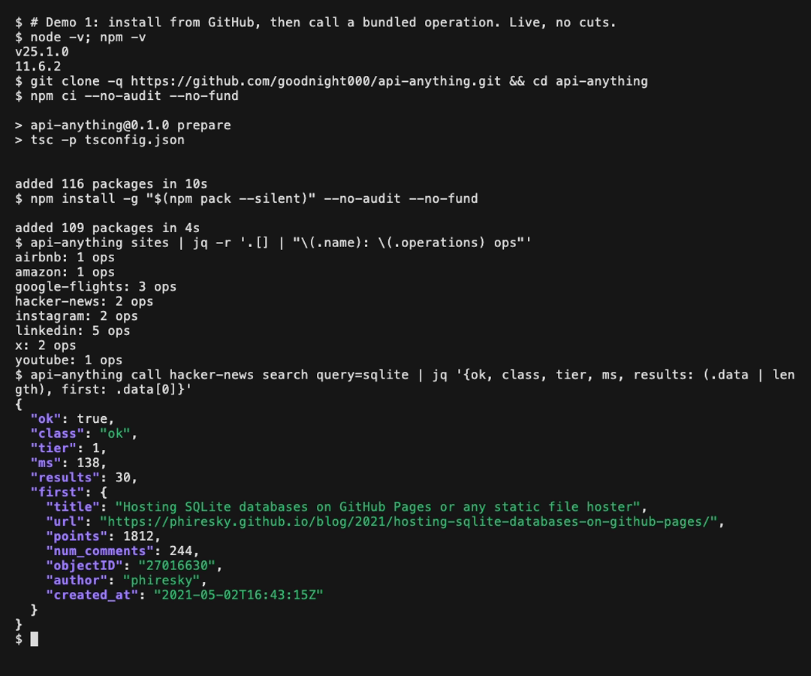
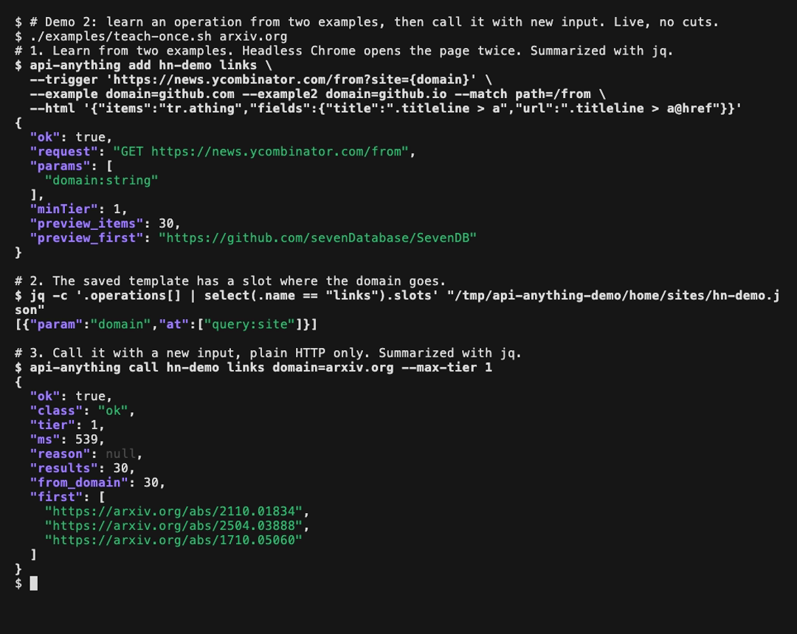
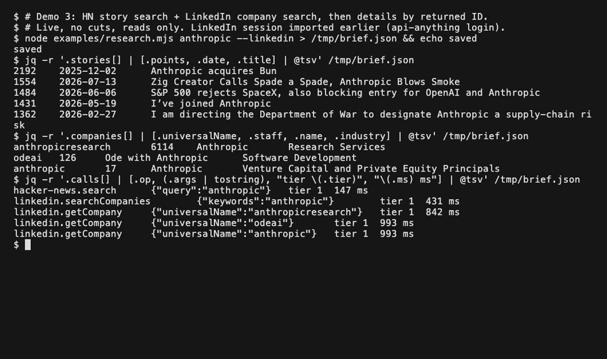
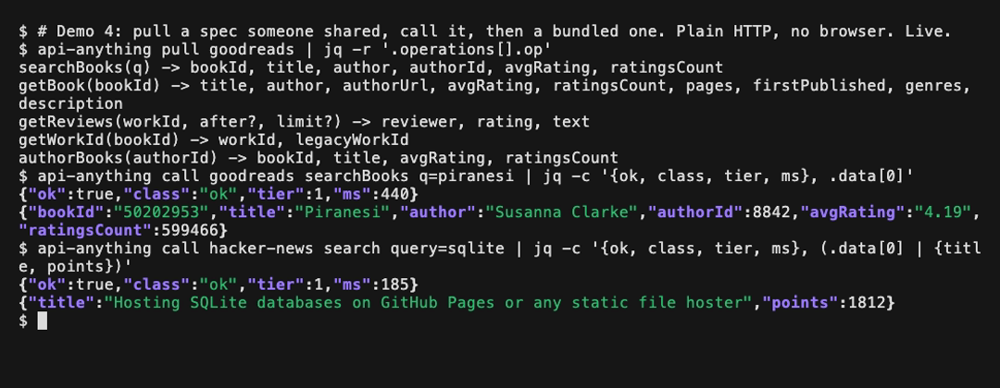
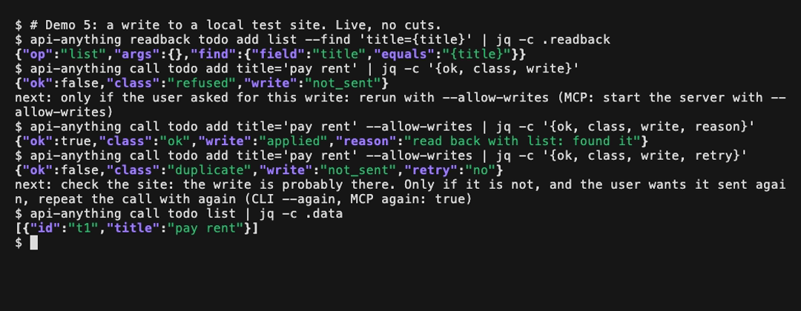

# Demos

Demos 1 to 3 were recorded on 2026-09-27 on macOS with Node 25.1.0 and npm 11.6.2, from commit
`56839a7` plus the example scripts on this branch. Demos 4 and 5 were recorded on 2026-10-26 with
the same Node and npm, from a build of commit `64d1ae2`. Each ran live with no cuts and no
speed-up. [VHS](https://github.com/charmbracelet/vhs) typed the commands. The `.txt` file next to
each GIF is the terminal text from the same run, and `research-brief.json` is the file demo 3
wrote. These are dated results. They do not show that a site answers the same way today.

Before each recording, an off-screen step pointed all state at `/tmp/api-anything-demo`: the
`API_ANYTHING_HOME` directory, the npm global prefix and, for demo 1, a new npm cache. The
`.tape` files contain that step. Demo 3 also copied an existing LinkedIn session, created with
`api-anything login linkedin`, into that directory. No cookie values, account names or raw captures
appear in the recordings or in this repository.

`jq` only formats the output below. Without it, the commands print one line of JSON.

## 1. First successful call

[](first-call.gif)

[Recording](first-call.gif) (33 s) · [transcript](first-call.txt) · [tape](first-call.tape)

```sh
git clone -q https://github.com/goodnight000/api-anything.git && cd api-anything
npm ci --no-audit --no-fund
npm install -g "$(npm pack --silent)" --no-audit --no-fund
api-anything sites | jq -r '.[] | "\(.name): \(.operations) ops"'
api-anything call hacker-news search query=sqlite | jq '{ok, class, tier, ms, results: (.data | length), first: .data[0]}'
```

```json
{
  "ok": true,
  "class": "ok",
  "tier": 1,
  "ms": 138,
  "results": 30,
  "first": {
    "title": "Hosting SQLite databases on GitHub Pages or any static file hoster",
    "url": "https://phiresky.github.io/blog/2021/hosting-sqlite-databases-on-github-pages/",
    "points": 1812,
    "num_comments": 244,
    "objectID": "27016630",
    "author": "phiresky",
    "created_at": "2021-05-02T16:43:15Z"
  }
}
```

The run used an empty npm cache: `npm ci` took 10 s and the global install 4 s. This call needs
neither Chrome nor an account. `npx -y github:goodnight000/api-anything call hacker-news search
query=sqlite` also worked with an empty cache, taking about 10 s. It was run without recording.

## 2. Teach once, call with new inputs

[](teach-once.gif)

[Recording](teach-once.gif) (25 s) · [transcript](teach-once.txt) · [tape](teach-once.tape) ·
[script](../../examples/teach-once.sh)

Run from the clone, with Chrome installed:

```sh
./examples/teach-once.sh arxiv.org
```

The script runs three commands and prints each before it runs:

1. `api-anything add` loads `news.ycombinator.com/from?site=github.com`, then `?site=github.io`,
   in headless Chrome. It saves `hn-demo.links`, with one parameter, `domain`.
2. `jq` reads the saved spec. The domain is stored as a slot, `{"param":"domain","at":["query:site"]}`,
   so later calls fill it in. They do not replay the github.com answer.
3. `api-anything call hn-demo links domain=arxiv.org --max-tier 1` calls the operation with a
   domain that was not used during learning. `--max-tier 1` allows only plain HTTP, with no
   browser.

```json
{
  "ok": true,
  "class": "ok",
  "tier": 1,
  "ms": 539,
  "reason": null,
  "results": 30,
  "from_domain": 30,
  "first": [
    "https://arxiv.org/abs/2110.01834",
    "https://arxiv.org/abs/2504.03888",
    "https://arxiv.org/abs/1710.05060"
  ]
}
```

`from_domain` counts the results whose URL host is the requested domain: 30 of 30. The script
exits nonzero if any result comes from another host. The recording then uses
[`examples/mcp-call.mjs`](../../examples/mcp-call.mjs), a scripted MCP client, to call the same
operation through `api-anything mcp` with `domain=nature.com`. That call returned 30 results
through tier 1, and the three shown are nature.com articles. An LLM agent makes the same
`call_operation` request, but the recording shows a script, not an agent.

## 3. Research workflow: stories plus LinkedIn companies

[](research.gif)

[Recording](research.gif) (20 s) · [transcript](research.txt) · [tape](research.tape) ·
[script](../../examples/research.mjs) · [full output](research-brief.json)

```sh
api-anything login linkedin          # once: imports your existing browser session
node examples/research.mjs anthropic --linkedin > brief.json
```

[`examples/research.mjs`](../../examples/research.mjs) calls `hacker-news.search`, then
`linkedin.searchCompanies`. It passes the `universalName` of each of the first three company
results to `linkedin.getCompany`. It stops with an error if any call fails or is truncated. The
output is a short brief with stories, companies, and a log of each call. From the transcript, with
some story lines left out:

```text
$ jq -r '.stories[] | [.points, .date, .title] | @tsv' /tmp/brief.json
2192    2025-12-02      Anthropic acquires Bun
1554    2026-07-13      Zig Creator Calls Spade a Spade, Anthropic Blows Smoke
...
$ jq -r '.companies[] | [.universalName, .staff, .name, .industry] | @tsv' /tmp/brief.json
anthropicresearch       6114    Anthropic       Research Services
odeai   126     Ode with Anthropic      Software Development
anthropic       17      Anthropic       Venture Capital and Private Equity Principals
$ jq -r '.calls[] | [.op, (.args | tostring), "tier \(.tier)", "\(.ms) ms"] | @tsv' /tmp/brief.json
hacker-news.search      {"query":"anthropic"}   tier 1  147 ms
linkedin.searchCompanies        {"keywords":"anthropic"}        tier 1  431 ms
linkedin.getCompany     {"universalName":"anthropicresearch"}   tier 1  842 ms
linkedin.getCompany     {"universalName":"odeai"}       tier 1  993 ms
linkedin.getCompany     {"universalName":"anthropic"}   tier 1  993 ms
```

The third result is a different company with the same name. The search returns what LinkedIn
returns, and a person or agent still decides which result is relevant. Every call is a read. The
script sends no messages or connection requests. Without `--linkedin`, it needs no account.
Without a LinkedIn session, the script stops at `searchCompanies` with `class: "auth"`
("HTTP 403 with login markers") and `next: ask the user to run: api-anything login linkedin`.

## 4. Pull a shared spec and call it

[](pull-call.gif)

[Recording](pull-call.gif) (16 s) · [transcript](pull-call.txt) · [tape](pull-call.tape)

```sh
api-anything pull goodreads | jq -r '.operations[].op'
api-anything call goodreads searchBooks q=piranesi | jq -c '{ok, class, tier, ms}, .data[0]'
api-anything call hacker-news search query=sqlite | jq -c '{ok, class, tier, ms}, (.data[0] | {title, points})'
```

```text
{"ok":true,"class":"ok","tier":1,"ms":805}
{"bookId":"50202953","title":"Piranesi","author":"Susanna Clarke","authorId":8842,"avgRating":"4.19","ratingsCount":599466}
{"ok":true,"class":"ok","tier":1,"ms":265}
{"title":"Hosting SQLite databases on GitHub Pages or any static file hoster","points":1812}
```

`pull` fetched `sites/goodreads.json` from this repository's main branch, checked it against the
shared rules, and listed its operations. Both calls went over tier 1, with no browser. `ms` covers
the whole call in a new process, DNS and TLS included. Over several runs the same day, the Hacker
News search took 133 to 412 ms, and once 1.7 s; the Goodreads search took 440 to 805 ms; one
Goodreads book page (`getBook`, not in the recording) took 1.3 to 1.5 s, and once 15.9 s. On Google
Flights, a server-rendered page, a call took a median of 1.17 s ([benchmark](../../bench/README.md)).

## 5. A write: refused by default, sent once, never twice

[](safety.gif)

[Recording](safety.gif) (20 s) · [transcript](safety.txt) · [tape](safety.tape) ·
[fixture](todo-fixture.mjs)

This runs against the test suite's local fixture site, not a real one: no write operation is
bundled. Off screen, [`todo-fixture.mjs`](todo-fixture.mjs) starts it and seeds two captures of its
to-do page, as `test/cli.test.ts` does, and `add` learns `todo.list` and `todo.add` from them. The
add was learned from a request the `--write` capture aborted, so nothing was sent while learning.

```text
$ api-anything readback todo add list --find 'title={title}' | jq -c .readback
{"op":"list","args":{},"find":{"field":"title","equals":"{title}"}}
$ api-anything call todo add title='pay rent' | jq -c '{ok, class, write}'
{"ok":false,"class":"refused","write":"not_sent"}
$ api-anything call todo add title='pay rent' --allow-writes | jq -c '{ok, class, write, reason}'
{"ok":true,"class":"ok","write":"applied","reason":"read back with list: found it"}
$ api-anything call todo add title='pay rent' --allow-writes | jq -c '{ok, class, write, retry}'
{"ok":false,"class":"duplicate","write":"not_sent","retry":"no"}
$ api-anything call todo list | jq -c .data
[{"id":"t1","title":"pay rent"}]
```

Without `--allow-writes` nothing is sent. With it, the write is sent once, and the readback (one
call to `list`, never a resend) finds the new item, so `write` is `applied`. The same write again
within 10 minutes is refused as `duplicate` and not sent; its `next` (on stderr, in the recording)
says to check the site first. The list holds one "pay rent", not two.

## Re-recording

```sh
brew install vhs              # also needs jq, Google Chrome and network access
docs/demos/record.sh          # or: docs/demos/record.sh teach-once
```

Demos 2 and 3 reuse demo 1's install, so run them in order. Demos 4 and 5 run this checkout's
build (`record.sh` builds it), and demo 5 needs `npm ci` for the fixture. Demo 3 reads the LinkedIn session
from `~/.api-anything` and never writes to it. Check each GIF's first and last frames before
committing a new recording.
